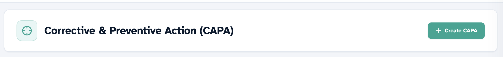
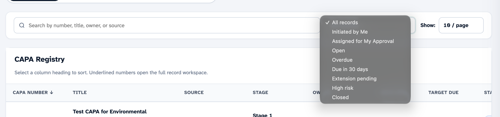
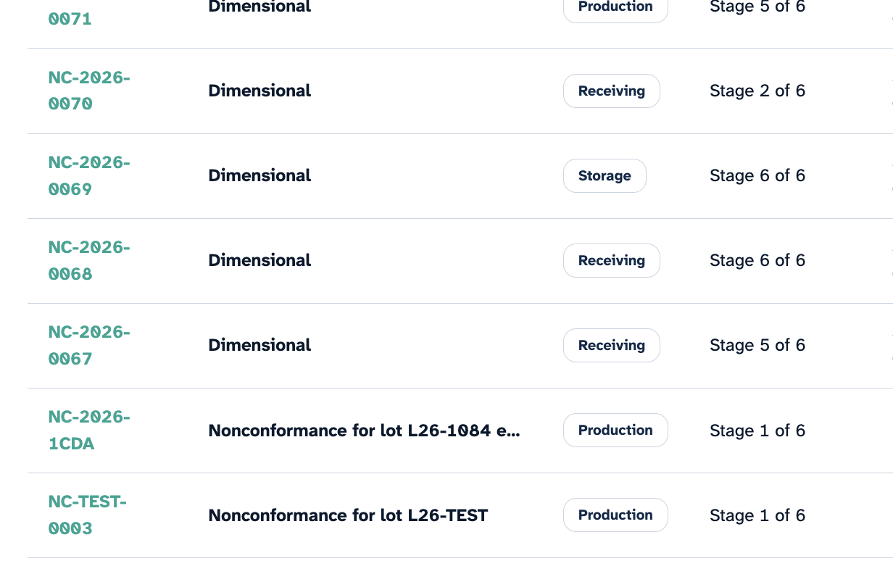
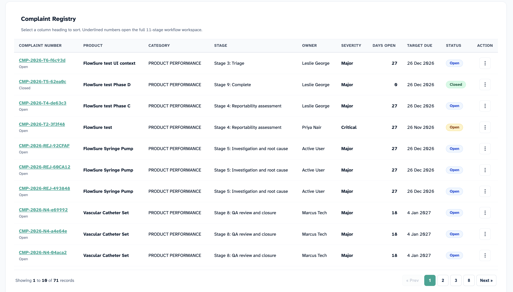
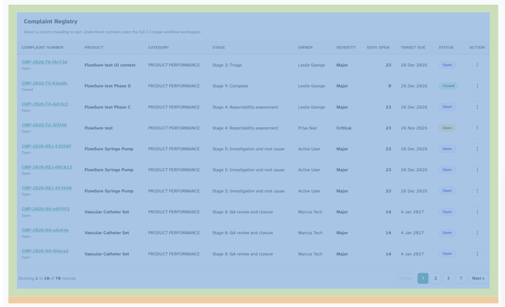
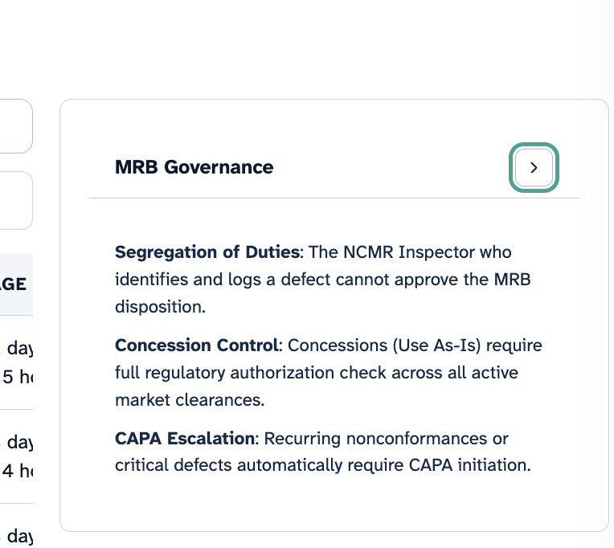
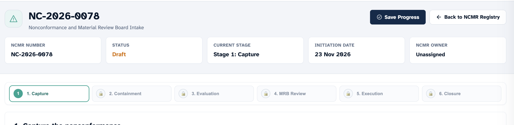
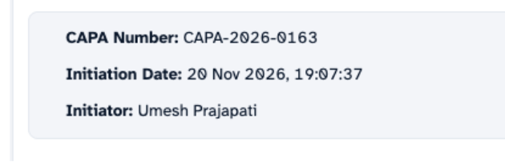

1. Keep the header section as CAPA - remove things like the ISO FDA green line (if there's any), question mark (if there's any), and button; it should be the same. Hover effect/color should be the same as the CAPA header!

- for eg: "ISO 13485:2016 §8.5.2 · FDA 21 CFR §820.100 · ISO 14971 · 21 CFR PART 11" - remove these stuff.

- make sure you see the header during the initiate page as well, there it should also be consistent! (just the buttons will get change as per the page like if its the initiation page then the button will be Back.. and etc. this is easy hope you will figure out)

- let me repeat- In the header, when we start or initiate the form, the header section should be the same as what I described for the main page of the modules; only the icon on the left-side heading and the button should work exactly how they do when we hover (Capa). We don't want the iso fda text etc. as i mentioned above, no question mark icon, no single-line description. Save progress, buttons back to Capa, or the back button color hover should be consistent.

2. The tab system should have separate HTML and URL: So like those tabs: the Registry, Overview, Records, etc.. (across all modules) are in one page only, so it should be like it should have separate URL/route, so if they want so they could open dedicatedly that tab only in any different page.

- Margin padding, fonts, size, etc. should remain the same as in CAPA 

- Tab names will be consistent, like remove the module prefix from the tab names (eg. CAPA Records, NCMR Records NO!, it should be simple - Records, Registry.. like that across all the modules - Heading should be only “Registry no prefix of Module name”). So these are the tabs that should be: 
    - Overview
    - Registry
    - Needs Attention(a Needs Attention tab will be there where its needed or in all modules where it is role-based, so users can check what they have to approve or check forms there as well)
    - Administration 

3. Filter Bar (search, filter, no. of pages) should be the same as CAPA in all across the modules; look for the margin padding and space above and below that section ( space of tabs and header, space between Table and Filter bar and make sure everything's consistent across all the modules)

4. The page and the content in it, like everything is not center-aligned: See as we zoom out they are going to top left - see the image: So instead it should be centered.

5. There should not be any space at the end when records end in the table - so there's currently spaces/gap left say let's see in NCMR like when a defect title is short and another is a little large so it leaves gap there in the table so this should not be there, and also the page number and footer section margins, etc., are not consistent;. So i'd say and what is decided is - take the example/reference of the Complaint registry table: just remove the extra margin from the left, right, and top and all so that it has the same pagination across all.

6. The Number Hyperlink fix (NCMR, Complaints etc..): So actually currently in lot places/modules there is hyperlink in the number so like clicking on that it is opening the clicked respective record/workspace - say NC-2026-0077, CMP-2026-T5-62ea0c etc.. SO remove the hyperlink from the modules - the number or whatever the ID is; make it black and bold normal; the rest will be as is. This is because already you know in the actions menu there is 'Open Workspace' so it is cool.

- make like this, simple no hyperlink:

7. The registry Page will be like CAPA: no right-side section (like in NCMR that MRB Governance slider/box remove that - we do not have to add it anywhere), no left section, nothing like this:

8. In the Number or ID, like CAPA number or complaint number or NCMR etc.. The format of the number should be Name-YEAR-number that's it and its already working fine in some modules i guess - (NC-2026-0077, etc).

9. The Records Tab - The year, months, and all filteration: So in some modules its folder based like 2025, 2026 boxes folders etc.. BUT now its decided to keep that tabular view with filters for different years and months etc. so for the reference see how it is done in - "Advisory Notices, Field Actions and Recalls" module, below is the screenshot for your reference: So see like this tabular view the records tab will be like this.

10. Overview Tab: For this, what we are suggesting is to keep 2-3 charts and only the KPI bar for now (May vary things a little for other modules). When any advisor or customer who is using the products needs that. So this tab should show the Data Analysis of these things, not just that (not customised, but what it really should show based on every customer POV). So yeah make those graphs, progress bars and all for the Overview tab - based on that specific module whatever is relevant to that.

11. Administration Tab should be hidden until we complete all the modules and implement the RBAC (Role based access control) - so maybe keep the tab button over there but as someone clicks on it show an alert saying - the relevant message that under development after RBAC will done blah blah like that...

12. While initiation step - say of NCMR or whatever - Save progress and save draft are doing the same thing; there should be one single button out of the two. So - keep the draft button at the bottom only! no duplications.

13. Remove those boxes where it shows the CAPA number or NCMR number, status and the middle part in the image basically, those boxes NCMR number, Status, current stage, initiate date etc, these should not be there. Then, in the progress bar where it shows which step it is, we do not have to show the numbers like 1,2,3,4, and also we don't have to show the text like 'stage 1'...2.., things like Phase 1, 2.., etc only we have to show the headings - no 1,2,3.. number no text like stage, phase..etc...

14. In the placeholders, remove the “e.g.” Let the example be there, but remove these "e.g." letters:

15. Remove The text below the input fields and put that data into a tooltip with “?” icon or “i” icon (only wherever it is relevant/required) and if someone hovers it, it should show the text, the detail out there.

16. For the Unique ID (CAPA no. , NCMR no.). Show auto-generated numbers like the image, but remove the time from initiation date. - Because see after point 13 those boxes will get removed right - so there should be a place where the relevant and important detail should be visible so:

17. 