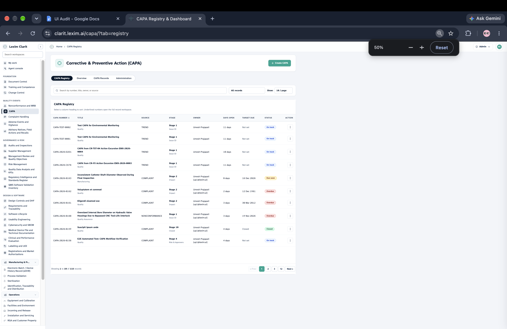
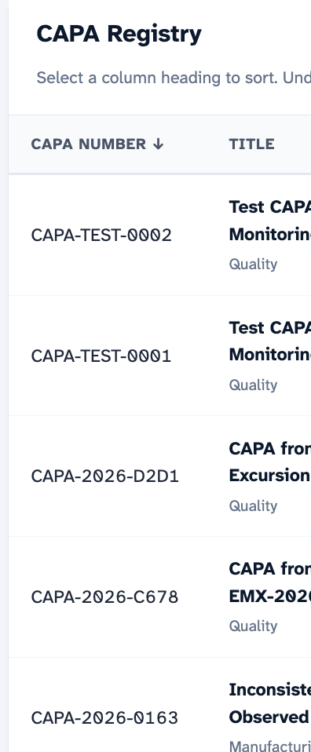
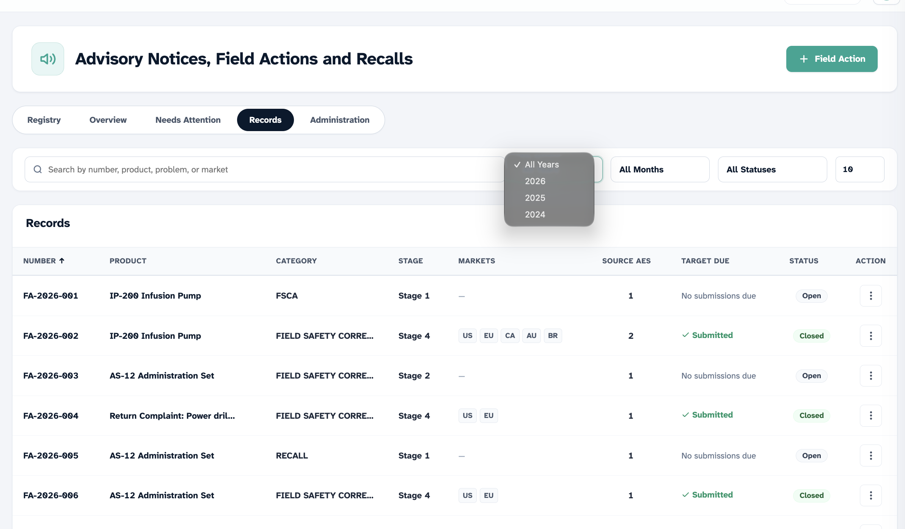
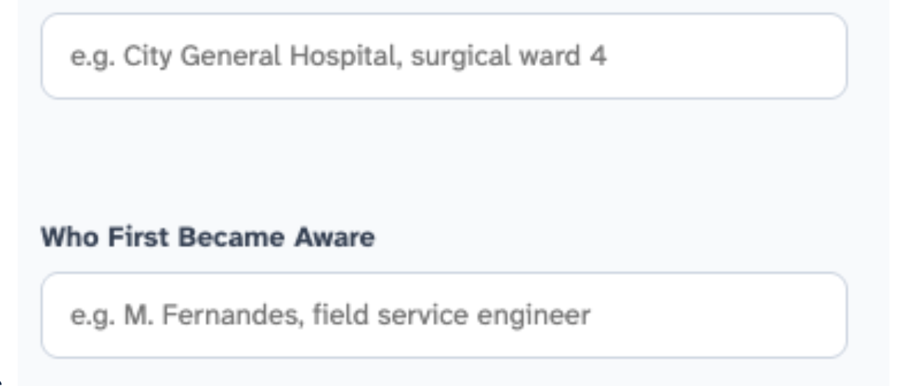
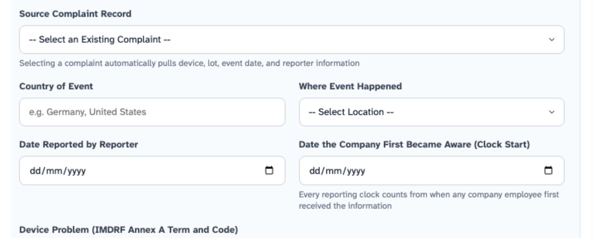
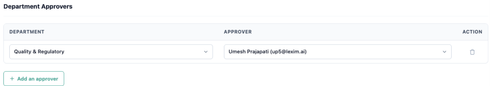
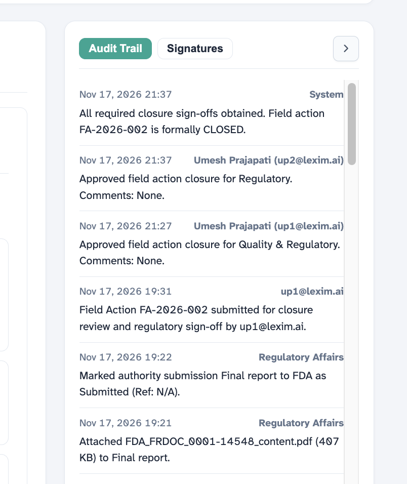
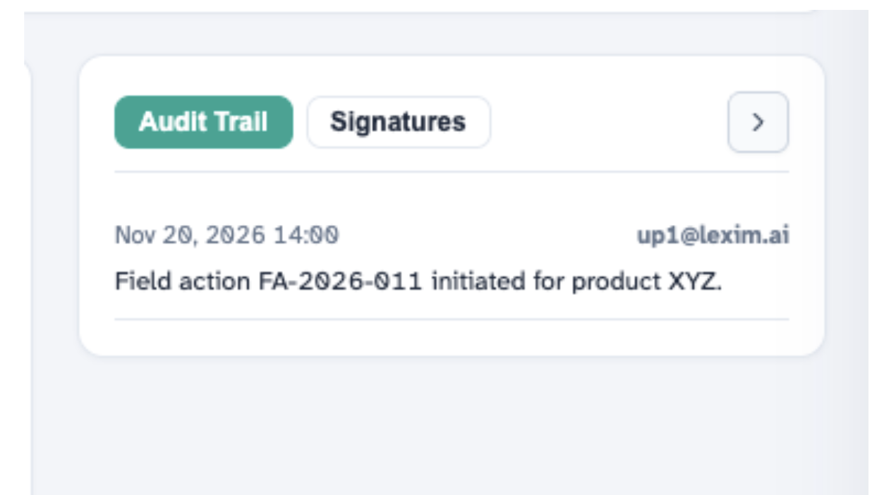

# Lexim Clarit - UI Consistency Audit (AI-agent briefing + decided points)

> **If you are an AI coding agent, read this whole top section before touching anything.**
> The 19 numbered points further down are the *decisions*. This section is the *context, scope, safety rules and method* for applying them.

---

## A. What this is and why it exists

Lexim Clarit is a Django 5 eQMS with ~45 module apps. Each developer owns a few modules and built them separately, so the UI drifted (headers, tabs, filter bars, tables, forms, buttons, audit trail, etc.).

The team held a meeting, reviewed **every half-built and fully-built module**, and for each UI element picked the **best implementation from whichever module did it best**. That module becomes the reference for that element everywhere. So:

- There is **no single "golden module"**. CAPA is the reference for some things (header, filter bar, spacing), Complaints for others (table footer/pagination), "Advisory Notices, Field Actions and Recalls" (`fieldaction`) for others (tabs-as-routes, Records tab, audit-trail drawer), Audit & Inspection (`internalaudit`) for the approvers UI, and so on. See section C.
- Modules are **not identical** (different purpose, different workflow stages, different roles). Apply the *look, structure and behaviour* of each decision, **not** one module's business logic. Where a point does not fit a module (e.g. no role-based approvals, so no "Needs Attention" content), adapt sensibly or skip and say so - never force it.
- The screenshots in `media/` are the visual source of truth for each point. Open and look at them; do not rely on the text alone. File names map to point numbers (`3.png` -> point 3, `5_a/b/c.png` -> point 5, etc.).

## B. Scope - whose modules, which branch

- This audit is applied **module by module, on that module's own branch**. Only work on the module(s) of the branch/folder the user is currently in (the user's modules: **Nonconformance/NCMR, Deviation, Manufacturing (eDHR/EBR)**). **Never touch other developers' modules**, even if you notice they are inconsistent - just mention it.
- Check the branch first: run `git branch --show-current` inside `lexim-clarit/`. `modules/manufacturing/` exists only on the `manufacturing-module` branch.
- The current module's code usually lives in `lexim-clarit/modules/<app>/` (views, urls, services), `lexim-clarit/templates/<app>/`, and `lexim-clarit/static/qmsui/{css,js}/`.

## C. Reference map (where to copy each pattern from)

Paths are relative to `lexim-clarit/`. **Verify the file still exists and read it before copying**; line numbers drift.

| Element (point) | Reference module | Where to look |
|---|---|---|
| Page header card, icon, hover/colour of buttons (1) | CAPA | `templates/capa/list.html`, `templates/capa/workspace.html` |
| Filter bar: search, filter, rows-per-page; spacing between tabs / filter bar / table (3) | CAPA | `templates/capa/list.html` |
| Table footer + pagination, no trailing blank space (5) | Complaints registry | `templates/complaints/list.html` |
| Tabs as separate routes/templates (2) | Field Actions, Internal Audit, Deviation (already do this) | `templates/fieldaction/{registry,overview,attention,records,admin}.html` + `base_fieldaction.html`, `modules/fieldaction/urls.py`; `templates/deviation/*`; `templates/internalaudit/*` |
| Tab bar *visual* style, margins, font, size (2) | CAPA | tab bar at `modules/capa/views.py` (~line 1018, `tabs` list) and `templates/capa/list.html` |
| Records tab as table + Year/Month/Status filters (9) | Field Actions | `templates/fieldaction/records.html` (see `media/9.png`) |
| Approvers table + "Add an approver" (18) | Internal Audit (new inspection/audit form) | `templates/internalaudit/new.html`, `static/qmsui/css/audit_new.css` (see `media/18.png`) |
| Audit Trail / Signatures right-side collapsible panel (19) | Field Actions | `templates/fieldaction/detail.html` (~line 1627, `toggleSidePanel`, `switchSideTab`) |
| Info box: ID, Initiation Date (no time), Initiator (16) | CAPA workspace | `templates/capa/workspace.html` (see `media/16.png`) |
| Overview KPIs + charts (10) | No single reference - design per module | see point 10 |

> Important: **CAPA is NOT the reference for tab names/URLs.** CAPA currently uses one page with `?tab=` and prefixed names ("CAPA Registry", "CAPA Records"). Point 2 is a decision that *CAPA itself will also change*; copy CAPA's visuals, not its tab naming/routing.

## D. STRICT RULES (non-negotiable)

1. **Do not break anything that already works.** This is a *consistency* task, not a refactor. Change only what a numbered point requires, in the smallest way that achieves it. No drive-by cleanups, renames, reformatting, dependency changes or "while I'm here" fixes. **If a point is already implemented in the current module (it already matches the decision/screenshot), leave it exactly as it is** - do not re-implement, "improve" or restyle it; just mark it "already consistent" in the audit. Only the gaps get changed.
2. **Never change behaviour/data/compliance logic for the sake of looks.** Workflow state machines, stage gating, e-signatures (21 CFR Part 11), audit-log writes, role/permission checks, validation, API contracts, models/migrations, and stored `stage_data`/`signatures`/`audit_log` JSON must keep working exactly as before. UI-only changes should stay UI-only. If a point seems to require a backend/model change (e.g. ID format in point 8), stop and ask first.
3. **Audit trail and signatures must remain complete and immutable.** Point 19 changes where/how they are *displayed*, never what is recorded or who can see it.
4. **Don't touch shared files without asking.** Files used by every module (`templates/base.html`, `templates/partials/*`, `templates/qmsui/partials/*`, shared CSS/JS under `static/qmsui/` that other modules load, `config/*`, `platform_apps/*`) are shared with other developers who are doing the same audit. Prefer changes scoped to the current module's own templates/CSS/JS. If a fix truly needs a shared file, tell the user, explain the blast radius, and wait for approval.
5. **Do not remove or rename URL names/routes that other code, tests, the IAM route table (`platform_apps/iam/routes.py`) or the sidebar rely on.** When adding the per-tab routes (point 2), keep the old URLs working (redirect) and register the new routes wherever the module's existing routes are registered.
6. **Existing records must keep working.** E.g. new ID format (point 8) applies to newly generated IDs only; never rewrite or migrate existing records' numbers without explicit approval.
7. **Cognito bypass files** - `cognito_auth/identity.py`, `platform_apps/iam/adapters/cognito.py`, `platform_apps/iam/services/authz.py`, `platform_apps/iam/services/role_members.py` - are intentionally modified locally. **Never stage, commit, restore or edit them.** Never run `git reset --hard` / `git checkout .`.
8. **No Node/npm/build step.** Frontend is Django templates + vanilla JS + CSS. Don't add libraries; for charts reuse whatever the project already uses (check `static/` and existing Overview tabs).
9. **Do not commit or push** unless the user asks. When git commands are needed, print them in the reply for the user to run.
10. **Don't guess silently.** If a point is ambiguous for this module, or the screenshot and text disagree, pick the least-invasive interpretation, state it clearly in your summary, and ask when the choice is risky.

## E. Method (follow this order)

1. Read this README fully and **look at every image** in `media/`.
2. Read `claude-stuff/notes/` for a note on the current module, and `DOCS/HANDOFF.md`.
3. **Audit first, no edits:** for the current module, go through points 1-19 and produce a checklist: *already consistent / needs change / not applicable (why)*, with the file(s) involved. Show it to the user and get a go-ahead unless they said to proceed directly.
4. Implement point by point (small, reviewable steps). After each point, re-check the pages you touched.
5. **Verify before claiming done** (from `lexim-clarit/`, Python 3.11 venv):
   - `python manage.py check` -> 0 issues
   - `python manage.py test tests.<relevant_test_module> --keepdb` -> all pass
   - Open the module in the browser: no JS console errors; click through registry, every tab, initiation flow, one existing record, save draft, submit/sign flow, audit panel, action menu. Also check at 50% zoom (point 4) and a narrow window.
   - `git status`: the 4 Cognito bypass files untouched/unstaged; only intended files changed.
6. Finish with a short report: what changed per point (files), what was skipped/not applicable and why, anything needing a decision, and anything you noticed in shared code or other modules but deliberately did not touch.

## F. Working interpretations of unclear points (edit if the team decides otherwise)

These resolve small contradictions/gaps in the notes below so agents behave consistently. **If the user states a different decision, the user wins.**

- **Canonical tabs and order** (point 2 lists four, point 9 adds Records): `Registry`, `Overview`, `Needs Attention`, `Records`, `Administration` - same as the Field Actions reference. Registry is the default landing tab. `Needs Attention` exists in **every** module (every user has tasks in whichever module they work in): it lists the records the logged-in user must act on (approve, review, sign, complete). If nothing is pending, show a friendly empty state - never hide the tab.
- **Centering (4)**: page width/centering is set **per module** in that module's own wrapper/CSS (not in `base.html`), so fix it in the current module only: constrain the page content to a max-width container with `margin: 0 auto` (CAPA's content width is the model) so it stays centered when zoomed out. No shared-file edit is needed.
- **Tab URLs**: each tab gets its own route and template, e.g. `/<module>/` (registry), `/<module>/overview/`, `/<module>/attention/`, `/<module>/records/`, `/<module>/admin/` (the pattern Deviation and Field Actions already use). Old `?tab=` links must redirect.
- **Administration tab (11)**: keep the tab visible; clicking it shows an "under development until RBAC is complete" message (alert/modal) and does not navigate or load a page.
- **Initiation page header (1, 12)**: same header card as the module page (icon + module title, no ISO/FDA line, no "?" icon, no one-line description). Right side shows only the contextual button(s), e.g. `Back to <Module>`, styled/hovering exactly like the CAPA header button. **"Save Progress" is not in the header** (point 12: only one save-draft button, at the bottom of the form).
- **Number/ID in tables (6)**: plain text, not a link, no underline, dark/black, same style as `media/6.png` (the CAPA number cell). Opening the record is done through the row Action menu -> "Open Workspace". Also update any helper text such as "Underlined numbers open the full record workspace" so it no longer claims numbers are clickable.
- **Step progress bar (13)**: show only the step title (e.g. "Capture", "Containment"), no leading number, no "Stage/Phase N" text. Lock/state icons may stay. This is about the progress bar only; do not change the registry's "Stage" column text.
- **ID format (8)**: `PREFIX-YYYY-NNNN` - prefix, year, then a **4-digit zero-padded sequence that counts up** and restarts each year (`NC-2026-0001`, `NC-2026-0002` ... `NC-2026-0077`; past 9999 it simply grows). 4 digits is the standard because CAPA (`CAPA-2026-0163`) and NCMR already use it; Field Actions currently uses 3 digits (`FA-2026-001`) but that is another developer's module. Only change a module whose *new* IDs don't follow this (hex suffixes, wrong padding, etc.). Note the generator is backend logic (e.g. NCMR numbers come from a DB trigger/service) - changing it is a backend change, so propose it and get approval first. Never renumber existing records.
- **Buttons (17)**: one consistent set - a secondary `Save Draft` (bottom only), a primary `Save & Continue` / next-step button, and a short `Submit` or `Complete` on the final step. Same size, radius, hover, disabled and **loading-spinner** behaviour everywhere; every async button must disable itself and show a spinner while its request is in flight to prevent double submits. **Keep labels short (1-3 words) and sizes uniform - no long wordy buttons.** If a button currently has long text that stretches it (e.g. "Submit for QA Manager Approval"), shorten the visible label to the action ("Submit") and move the extra detail into a tooltip/`title`/helper copy - without changing what the button does. Don't change the button's handler or endpoint.
- **Tooltips (15)**: move helper text under inputs into an `i`/`?` tooltip only where it genuinely helps; very short/obvious hints can simply be dropped; any text that is a *validation or error message* stays visible.
- **Placeholders (14)**: remove only the literal `e.g.` prefix; keep the example (e.g. `e.g. Germany` -> `Germany`).

## G. Per-module status (update only when the user asks)

| Point | NCMR | Deviation | Manufacturing |
|---|---|---|---|
| 1 Header | ☐ | ☐ | ☐ |
| 2 Tabs as routes + names | ☐ | ☐ | ☐ |
| 3 Filter bar | ☐ | ☐ | ☐ |
| 4 Centered layout | ☐ | ☐ | ☐ |
| 5 Table footer/pagination | ☐ | ☐ | ☐ |
| 6 No ID hyperlink | ☐ | ☐ | ☐ |
| 7 Registry has no side box | ☐ | ☐ | ☐ |
| 8 ID format | ☐ | ☐ | ☐ |
| 9 Records tab (table + filters) | ☐ | ☐ | ☐ |
| 10 Overview (KPIs + 2-3 charts) | ☐ | ☐ | ☐ |
| 11 Administration placeholder | ☐ | ☐ | ☐ |
| 12 Single draft button | ☐ | ☐ | ☐ |
| 13 No info boxes / plain stepper | ☐ | ☐ | ☐ |
| 14 No "e.g." | ☐ | ☐ | ☐ |
| 15 Tooltips | ☐ | ☐ | ☐ |
| 16 Info box (ID, date, initiator) | ☐ | ☐ | ☐ |
| 17 Consistent buttons + spinners | ☐ | ☐ | ☐ |
| 18 Approvers UI | ☐ | ☐ | ☐ |
| 19 Audit/Signatures panel | ☐ | ☐ | ☐ |

## H. Copy-paste prompt (use in any module/branch)

```text
Read DOCS/CONSISTENCY/README.md completely (sections A-H and all 19 points) and look at every image in DOCS/CONSISTENCY/media/. Then make the module I'm currently working in (<MODULE NAME>, on the current git branch) UI-consistent with the decided points.

Rules: follow section D strictly. Change only what the points require, do not break or alter anything that already works (workflows, e-signatures, audit logs, permissions, URLs, data), do not edit shared files (base.html, partials, shared CSS/JS) or other modules without asking me, and never touch the 4 Cognito bypass files.

Step 1: do NOT edit yet - give me the audit checklist for this module (per point: already consistent / needs change / not applicable, with files). Step 2: after I approve, implement point by point, then run manage.py check, the relevant tests, and tell me what to click-test in the browser. Don't commit; print any git commands for me to run.
```

*(To skip the approval step, replace "Step 1/Step 2" with "audit and implement directly, then report".)*

---

## Decided points

1. Keep the header section as CAPA - remove things like the ISO FDA green line (if there's any), question mark (if there's any), and button; it should be the same. Hover effect/color should be the same as the CAPA header!

- for eg: "ISO 13485:2016 §8.5.2 · FDA 21 CFR §820.100 · ISO 14971 · 21 CFR PART 11" - remove these stuff.

- make sure you see the header during the initiate page as well, there it should also be consistent! (just the buttons will get change as per the page like if its the initiation page then the button will be Back.. and etc. this is easy hope you will figure out)

- let me repeat- In the header, when we start or initiate the form, the header section should be the same as what I described for the main page of the modules; only the icon on the left-side heading and the button should work exactly how they do when we hover (Capa). We don't want the iso fda text etc. as i mentioned above, no question mark icon, no single-line description. Save progress, buttons back to Capa, or the back button color hover should be consistent.


<hr/>

2. The tab system should have separate HTML and URL: So like those tabs: the Registry, Overview, Records, etc.. (across all modules) are in one page only, so it should be like it should have separate URL/route, so if they want so they could open dedicatedly that tab only in any different page.

- Margin padding, fonts, size, etc. should remain the same as in CAPA 

- Tab names will be consistent, like remove the module prefix from the tab names (eg. CAPA Records, NCMR Records NO!, it should be simple - Records, Registry.. like that across all the modules - Heading should be only “Registry no prefix of Module name”). So these are the tabs that should be: 
    - Overview
    - Registry
    - Needs Attention(a Needs Attention tab will be there where its needed or in all modules where it is role-based, so users can check what they have to approve or check forms there as well)
    - Administration 

<hr/>

3. Filter Bar (search, filter, no. of pages) should be the same as CAPA in all across the modules; look for the margin padding and space above and below that section ( space of tabs and header, space between Table and Filter bar and make sure everything's consistent across all the modules)


<hr/>

4. The page and the content in it, like everything is not center-aligned: See as we zoom out they are going to top left - see the image: So instead it should be centered.



<hr/>

5. There should not be any space at the end when records end in the table - so there's currently spaces/gap left say let's see in NCMR like when a defect title is short and another is a little large so it leaves gap there in the table so this should not be there, and also the page number and footer section margins, etc., are not consistent;. So i'd say and what is decided is - take the example/reference of the Complaint registry table: just remove the extra margin from the left, right, and top and all so that it has the same pagination across all.


<hr/>

6. The Number Hyperlink fix (NCMR, Complaints etc..): So actually currently in lot places/modules there is hyperlink in the number so like clicking on that it is opening the clicked respective record/workspace - say NC-2026-0077, CMP-2026-T5-62ea0c etc.. SO remove the hyperlink from the modules - the number or whatever the ID is; make it black and bold normal; the rest will be as is. This is because already you know in the actions menu there is 'Open Workspace' so it is cool.

- make like this, simple no hyperlink:



<hr/>

7. The registry Page will be like CAPA: no right-side section (like in NCMR that MRB Governance slider/box remove that - we do not have to add it anywhere), no left section, nothing like this:


<hr/>

8. In the Number or ID, like CAPA number or complaint number or NCMR etc.. The format of the number should be Name-YEAR-number that's it and its already working fine in some modules i guess - (NC-2026-0077, etc).

<hr/>

9. The Records Tab - The year, months, and all filteration: So in some modules its folder based like 2025, 2026 boxes folders etc.. BUT now its decided to keep that tabular view with filters for different years and months etc. so for the reference see how it is done in - "Advisory Notices, Field Actions and Recalls" module, below is the screenshot for your reference: So see like this tabular view the records tab will be like this.



<hr/>

10. Overview Tab: For this, what we are suggesting is to keep 2-3 charts and only the KPI bar for now (May vary things a little for other modules). When any advisor or customer who is using the products needs that. So this tab should show the Data Analysis of these things, not just that (not customised, but what it really should show based on every customer POV). So yeah make those graphs, progress bars and all for the Overview tab - based on that specific module whatever is relevant to that.

<hr/>

11. Administration Tab should be hidden until we complete all the modules and implement the RBAC (Role based access control) - so maybe keep the tab button over there but as someone clicks on it show an alert saying - the relevant message that under development after RBAC will done blah blah like that...

<hr/>

12. While initiation step - say of NCMR or whatever - Save progress and save draft are doing the same thing; there should be one single button out of the two. So - keep the draft button at the bottom only! no duplications.

<hr/>

13. Remove those boxes where it shows the CAPA number or NCMR number, status and the middle part in the image basically, those boxes NCMR number, Status, current stage, initiate date etc, these should not be there. Then, in the progress bar where it shows which step it is, we do not have to show the numbers like 1,2,3,4, and also we don't have to show the text like 'stage 1'...2.., things like Phase 1, 2.., etc only we have to show the headings - no 1,2,3.. number no text like stage, phase..etc...


<hr/>

14. In the placeholders, remove the “e.g.” Let the example be there, but remove these "e.g." letters:



<hr/>

15. Remove The text below the input fields and put that data into a tooltip with “?” icon or “i” icon (only wherever it is relevant/required) and if someone hovers it, it should show the text, the detail out there.



<hr/>

16. For the Unique ID (CAPA no. , NCMR no.). Show auto-generated numbers like the image, but remove the time from initiation date. - Because see after point 13 those boxes will get removed right - so there should be a place where the relevant and important detail should be visible so:


<hr/>

17. Buttons for the next step should be the same for all the steps, and all the modules should be Save and  - basically these next and all buttons should be consistent across all modules. A Complete or Submit button that is it what is required keep it short and simple, there is no need to make a large button with text in it - so make sure everything should be consistent the hover effects the loader and all.

- make sure every button should have a loading spinner effect, so that we could stop unnecessary repetitive clicks.

<hr/>

18. For adding the approvers, follow this UI below: i gues its in the audit and inspection module im not sure you can check and confirm it:, so make sure the places wherever the approvers adding is there so make sure that table and adding UI and all should be like this:



<hr/>

19. Regarding the AUDIT TRAILS & SIGNATURES: So there's a new UI for this that is being decided to keep the audit trails: so for reference see the 'Advisory Notices, Field Actions and Recalls' module see how it can be slided/collapsed from the right side there so it should be like this across all the modules: and yeah also keep the signatures like in this way.





<hr/>

